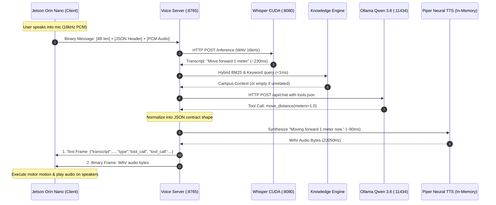

# D-Bot End-to-End Voice & Tool Calling Pipeline Specification

A comprehensive technical guide to the real-time Speech-to-Speech (S2S) and Action Execution pipeline between the **Jetson Orin Nano (Robot D-Bot)** and the **Jetson AGX Thor (AI Compute Server)**.

---

## 1. High-Level System Architecture



---

## 2. The Binary Audio Framing Protocol (Orin $\rightarrow$ Thor)

### A. Byte-Level Wire Layout

Every voice utterance recorded by the robot microphone is packed into a single binary WebSocket message:

```
+---------------------------+-------------------------------+-----------------------------------------+
| Field 1: Header Length    | Field 2: Header JSON Payload  | Field 3: Raw Audio Payload              |
| 4 Bytes (uint32, LE)      | N Bytes (UTF-8 Encoded)       | M Bytes (Binary Linear PCM)             |
+---------------------------+-------------------------------+-----------------------------------------+
| Example: 0x18 0x00 0x00 0x00 | {"session_id":"robot-01"}     | \x00\x00\x1f\x02\xf4\xff ...            |
+---------------------------+-------------------------------+-----------------------------------------+
```

### B. Current Header JSON Schema

```json
{
  "session_id": "robot-session-01"
}
```

Optional expandable fields supported in future revisions:
- `"robot_id"`: (string) Identifier of the physical robot (e.g., `"dbot-alpha"`).
- `"timestamp"`: (float) Epoch time of recording start.
- `"sample_rate"`: (int) Default: `16000`.

### C. Audio Specifications
- **Encoding**: 16-bit Signed Linear PCM (`int16`, little-endian).
- **Channels**: 1 (Mono).
- **Sample Rate**: 16,000 Hz.
- **Duration**: Typically 2.0 to 4.5 seconds per conversational turn.

### D. Packing & Unpacking Implementation

#### Client Packing (Python / Orin Nano):
```python
import struct
import json

def pack_audio(pcm_bytes: bytes, session_id: str = "robot-01") -> bytes:
    header_json = json.dumps({"session_id": session_id}).encode("utf-8")
    header_len = struct.pack("<I", len(header_json))  # 4 bytes little-endian uint32
    return header_len + header_json + pcm_bytes
```

#### Server Unpacking (Python / AGX Thor):
```python
import struct
import json

def unpack_audio(data: bytes):
    if len(data) >= 4:
        header_len = struct.unpack("<I", data[:4])[0]
        if 0 < header_len < len(data) - 4:
            header_json = json.loads(data[4:4 + header_len].decode("utf-8"))
            session_id = header_json.get("session_id", "")
            raw_pcm = data[4 + header_len:]
            return session_id, raw_pcm
    return "", data
```

---

## 3. Server Pipeline Stages (Deep Dive)

### Stage 1: Speech-to-Text (STT) via Whisper.cpp CUDA Server
- **Server**: `whisper_build/bin/whisper-server` running on port `8080`.
- **Model**: `ggml-large-v3-turbo-q5_0.bin` (~573 MB VRAM).
- **Acceleration**: Native SM 11.0 Blackwell GPU compilation with Flash Attention (`--flash-attn`).
- **Processing**: The raw PCM audio is formatted into a memory WAV container and posted to `http://127.0.0.1:8080/inference`.
- **Latency**: **~200 – 260 ms** for a 4.5-second utterance.
- **Hallucination Suppression**: Filters common Whisper silence hallucinations (`"thanks for watching"`, `"you"`, `""`, etc.).

---

### Stage 2: Knowledge Engine (RAG)
- **Engine**: In-memory BM25 retrieval index combined with direct keyword boosting (`knowledge_engine.py`).
- **Data Source**: Cleaned campus documentation (`clean_research.txt` and `raw_research.txt`).
- **Dynamic Gating**: If the query has zero matching keywords to JUIT campus facts (e.g. *"Tell me a joke"*, *"Move forward 1 meter"*), the context returns empty `""`, ensuring non-campus queries are not contaminated with irrelevant text.
- **Latency**: **< 1 ms**.

---

### Stage 3: LLM Intent Identification & Tool Calling via Ollama
- **Endpoint**: `http://127.0.0.1:11434/api/chat`
- **Model**: `qwen3.8:27b`
- **Configuration**:
  - `tools`: Dynamically loaded from `tools.json`.
  - `temperature`: `0.5`
  - `top_p`: `0.9`
  - `num_predict`: `160` (keeps responses to 1–2 spoken sentences).

#### Available Tools in `tools.json`:
1. `move_distance(meters: float)`: Positive = forward, negative = backward.
2. `rotate(degrees: float)`: Positive = counterclockwise (left), negative = clockwise (right).
3. `navigate_to(location: string)`: Sends robot to named campus waypoint.
4. `navigate_and_deliver(location: string, item: string)`: Navigates and delivers an item.
5. `stop()`: Emergency halt / cancels all motion immediately.

---

### Stage 4: Response Normalization Contract
Regardless of internal Ollama output structures, the server normalizes the response into an explicit contract:

```typescript
interface DbotResponseContract {
  transcript: string;           // Exact text transcribed from user speech
  type: "speak" | "tool_call";  // Type of interaction
  text: string;                 // Spoken text response (synthesized into audio)
  tool_call?: {                 // ONLY present when type === "tool_call"
    name: string;               // Tool function name
    args: Record<string, any>;  // Strongly typed arguments
  };
}
```

#### Examples:

**Action Intent (`type: "tool_call"`):**
```json
{
  "transcript": "Move forward 1 meter",
  "type": "tool_call",
  "text": "Moving forward 1 meter now.",
  "tool_call": {
    "name": "move_distance",
    "args": {
      "meters": 1.0
    }
  }
}
```

**Conversational Intent (`type: "speak"`):**
```json
{
  "transcript": "Where is the Drobotics lab?",
  "type": "speak",
  "text": "The Drobotics Lab is located in ECL 5 in the Department of Electronics and Communication Engineering."
}
```

---

### Stage 5: Neural Text-to-Speech (TTS)
- **Engine**: In-memory Piper TTS (`en_US-hfc_female-medium.onnx`).
- **Input**: The normalized `contract["text"]` string.
- **Output**: 16-bit 22,050 Hz Mono WAV audio.
- **Latency**: **~70 – 110 ms** per sentence.

---

### Stage 6: Dual-Message WebSocket Response Transmission (Thor $\rightarrow$ Orin)
The server transmits the response back to the client in **two distinct messages in strict sequential order**:

1. **Message 1 (Text WebSocket Frame)**:
   The UTF-8 JSON string containing the normalized `DbotResponseContract`.
2. **Message 2 (Binary WebSocket Frame)**:
   The complete binary WAV file bytes of the synthesized `"text"`.

---

## 4. End-to-End Latency Profile (Jetson AGX Thor)

| Step | Operation | Latency |
|---|---|---|
| **1** | Audio Transmission (Orin $\rightarrow$ Thor via Wi-Fi AP) | **~10 – 25 ms** |
| **2** | Whisper CUDA Transcription (`ggml-large-v3-turbo-q5_0`) | **~200 – 260 ms** |
| **3** | Hybrid RAG Context Retrieval | **< 1 ms** |
| **4** | Ollama Chat & Tool Calling Decision (`qwen3.8:27b`) | **~900 – 1400 ms** |
| **5** | Piper TTS Speech Synthesis (`en_US-hfc_female-medium`) | **~80 – 120 ms** |
| **6** | Response Dispatch (JSON Contract + WAV Binary Frame) | **~5 – 10 ms** |
| **Total** | **Full User Query to Robot Action & Speech** | **~1.2 – 1.8 s** |

---

## 5. Network Configuration & Ports

- **Wi-Fi AP IP (Default Robot Interface)**: `10.42.0.1`
- **Ethernet Static IP**: `172.16.32.29`
- **Voice WebSocket & Web UI**: Port `8765` (`ws://10.42.0.1:8765/ws`)
- **Whisper CUDA Server**: Port `8080` (Internal daemon)
- **Ollama LLM Server**: Port `11434` (Internal daemon)
